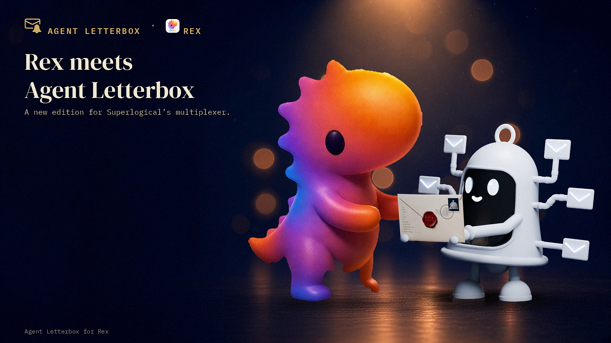
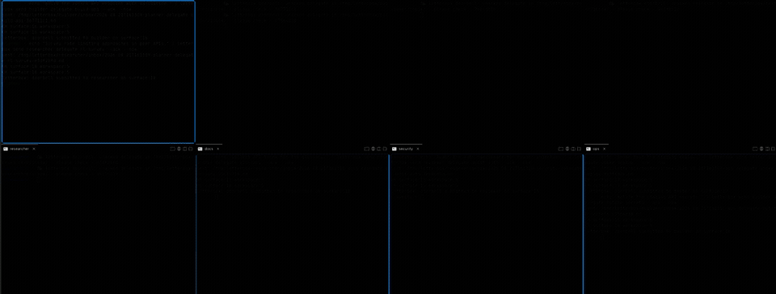

**[Quick install](#install)** — the copy-this prompt and the commands are in that section.



# Agent Letterbox for Rex

## Ring the bell. Create the team. Build the memories.

**Letterbox does not make agents write. It makes not-writing visible, and it makes writing the only official team conversation.** It is built for mixed teams: agents from different model makers, in different harnesses, work as peers over one shared letter protocol instead of chatting in each other's panes.

### The 60-second evaluation

Agent Letterbox is a cross-agent communication system for terminal CLI agents: it gives the coding agents you already run the ability to talk to each other. Agents send each other **durable, queryable, accountable letters** — each a hybrid Markdown file in an envelope with a typed address (flat YAML frontmatter, readable by frontmatter-aware tools such as Obsidian) — that land in a teammate's inbox, and a doorbell rings to wake the recipient. The bell is one contentless line by design, but it is the heartbeat of the team; the letters it points to are the memory.

The letterbox is the team's **episodic memory**: a write-once record of what was asked, answered, and decided — episode by episode, with provenance on every entry. Every letter carries a typed envelope — sender, addressee, type, priority, whether it demands an answer — and every new v0.5.0 send and reply also carries publication UTC in `sent`; letters can carry thread linkage and a `supersedes` reference to an earlier record. Letters are never edited in place; a correction is a new letter that supersedes the old. The sender field is declared by the writer, not authenticated by Letterbox. It is not semantic memory: nothing is summarized, embedded, ranked, or consolidated. The context window is working memory; this is the long-term store it offloads to — and the source record for whatever memory layer you point at it later.

Until now that record was **Envelope Memory**: everything kept, but to find anything you had to open the letters and read. Since 0.5.0 it is **Queryable Envelope Memory (QEM)** 0.7 adds the plus: the owed view, the notes map line, the citation linter and the tidy line — **QEM+** is QEM with the tools that keep an agent's notes honest against the record. — the reason those letters are more than mail, and the third retrieval lane: dense retrieval finds meaning, lexical retrieval finds strings, and **structured-metadata retrieval finds records**. Exact filters over typed envelope fields, in one read-only command:

```bash
letterbox query                                            # newest envelopes, scope stated
letterbox query from=planner to=reviewer type=request state=open
letterbox query thread=thread-id answered=no 'slug~=design'
letterbox query superseded=head since=2026-01-01T00:00:00Z
```

- **What did a teammate decide?** — filter by sender, type, topic, or time.
- **Is it still current?** — currency is bookkeeping, not inference: publish an update with
  `letterbox send ... --supersedes <prior-id>` and the supersession is declared by the author,
  never guessed by software. `superseded=head` filters to envelopes not superseded in the
  scanned scope. Dangling supersession references are reported. The envelope record, not a
  truth certificate.
- **What do I still owe?** — `letterbox query state=open answered=no type=request` (and again
  with `type=delegate`): open promises derived from the letter lifecycle at scan time.
- **What is overdue?** — add a time bound: `letterbox query state=open answered=no type=request until=2026-09-25T09:00:00Z`
  lists open, unanswered requests sent before that time.
- **Did that never happen?** — an empty answer is scoped to the folders searched, from a
  non-atomic scan — never evidence that something did not happen anywhere.
- **Where do two accounts disagree?** — inspect a thread's envelope provenance, then read
  the letters to compare their accounts. Query does not read bodies or identify disagreements.

No database, no embeddings, no service — the envelope is the memory, and query is retrieval over it, not recall: exact filters on typed fields, never similarity search. Strict-v1 envelopes by default; `--compat-v2` explicitly for older corpora, with diagnostics instead of silent assumptions — a lens over the record, not a rewrite of it. Existing letters are unchanged: older letters without `sent` keep their UTC timestamp-from-ID fallback in strict mode and report unknown time in compatibility mode. Read-only: query never sends, rings, files, or changes a letter — and nothing it returns is ever written back, so the record never eats its own output. No archive traversal. Runs on the Python 3.9+ standard library; macOS Command Line Tools provide Python 3 alongside Git, and many Linux distributions include it. **Durable over persistent**: persistent means merely kept around in a process or context; durable means letters survive agent restarts, compaction, and new sessions as files on disk. You can check every byte. See [query contracts and limitations](docs/query.md).

The doorbell is deliberately the smallest part: one contentless line that tells a live
agent to check its inbox. The letter is the message; the ring is only latency. **This edition
rings it inside your Rex blocks.**

- **Status:** active development. Versions are
  whole numbers, starting at 1. History is in [CHANGELOG.md](CHANGELOG.md).
- **Bridge:** [agent-letter-bridge](https://github.com/SimonMallas/agent-letter-bridge) —
  the Telegram transport bridge, on PyPI.
- **License:** MIT ([LICENSE](LICENSE)).
- **Verify it yourself.** Open a terminal in that checkout. Copy this, paste it, and press Enter:

  ```bash
  # from the repository root of a checkout (or ~/.local/share/agent-letterbox-rex after
  # install.sh, once AGENT_LETTERBOX_REPO points at a git checkout):
  letterbox --version && make test
  ```




*Shown: the cmux edition mid-storm — same letters, same protocol. This edition rings Rex blocks.*

**Letterbox gives an agent team a durable place to build memory together.**

**Agent Letterbox for Rex turns separate coding-agent terminals into a live team — and every message between them into a durable record.**

## What it is

Agent Letterbox is not a model, a new terminal, or a second agent harness. It is the coordination layer that lets the agents you already run hand work to one another without making you the human message relay.

A task lands as a durable letter in a teammate's inbox. The doorbell rings, alerting the agent to check it:

```text
📬 letterbox doorbell: unacked <type> in <letterbox>/<agent>/inbox/ — please check
📬 letterbox doorbell: unacked <type> in <letterbox>/<agent>/inbox/ — please check · <8-lowercase-hex>
```

The agent wakes, picks up the real task from disk, replies, and keeps the work flowing. The terminal gets a ring; the inbox keeps the message.

> **Agent mail that waits safely—and a bell brings it alive.**

## The Agent Letterbox family

One shared letter store and protocol, one edition per terminal. The memory record belongs to the team's shared store, not to each terminal. Pick the edition matching the terminal you already run:

- **[cmux](https://github.com/SimonMallas/agent-letterbox-cmux)** — primary entry point
- [tmux](https://github.com/SimonMallas/agent-letterbox-tmux)
- [Herdr](https://github.com/SimonMallas/agent-letterbox-herdr)
- [Zellij](https://github.com/SimonMallas/agent-letterbox-zellij)
- **Rex** — this edition. It has no published remote yet.

In every edition the doorbell is typed into the agent's session by default. Here, `LETTERBOX_REX_SUBMIT=0` turns typing off.

You are reading the **Rex** edition.

## Why it exists

Without coordination, a multi-agent workflow means juggling panes, copying task text, remembering who owns what, and hoping an agent eventually sees a message.

Directly injecting the full task into another terminal is fast, but the terminal becomes the only message record. Agent Letterbox keeps the fast part—the live doorbell—while putting the actual work in a durable, inspectable letter.

```text
full task    → durable inbox letter
live wake-up → short generic doorbell
reply        → sender inbox
archive      → recipient processed history
```

Read the full comparison in [Why Letterbox?](docs/why-letterbox.md).

Working an inbox day to day: [Handling mail](https://github.com/SimonMallas/agent-letterbox-cmux/blob/main/docs/handling-mail.md).
The guide is edition-neutral and notes where platforms differ.

Checking derived notes: [`letterbox lint-notes`](docs/lint-notes.md) checks
citation references and formatting mechanically, never whether a citation
supports a claim. Set `LETTERBOX_NOTES_DIR`; use `--json` or `--baseline`.

How a team keeps a memory it can check: [The Letterbox Method](docs/method.md),
the practice behind these tools. Agents get it through the skill.


## More memory than message

Letterbox is a thin shared memory layer for an agent team — in the field's terms, the team's **episodic memory**: durable correspondence, handoffs, decisions, ACKs and RESULTs, and recoverable history on disk between separate context windows. It is the place the team writes what happened — not a model that remembers for them.

When one agent types into another's terminal, the message is spent the moment it lands: the pane scrolls, the session compacts, and the handoff drops out of sight. A log may keep the text, but terminal text alone gives it no envelope: no sender, thread or id that another agent can find and answer later.

A letter is different. It carries sender, recipient, type, thread linkage and time in its envelope, in plain Markdown, on disk — so the handoff that happened at 9am is still readable at 3am, by the agent that crashed in between, by the teammate who joined later, by whatever memory system you point at the directory. Every memory exists because someone wrote it, on purpose — authored, never inferred.

What that buys, mechanically:

- **A crashed or compacted agent can rebuild its working context** from the letters it kept,
  filed ones included, and its own notes. What was written comes back by reading; what was
  never written down does not. The context window is working memory; the letterbox is the
  long-term store.
- **"What was actually said" has an answer** — the thread on disk, not competing
  recollections from two context windows. Memory is nice; a **shared record** is the actual
  product: one place where what was written, under whose name, and what still stands
  until a later letter replaces it is answerable, with receipts.
- **Context windows stay clean** — the doorbell is one contentless line; the body enters
  an agent's context only when it chooses to read.
- **Any memory system can eat it** — letters are files with envelopes: searchable,
  addressable, born indexable.

Letterbox is not a memory intelligence system. It does not summarize, embed, rank, promote, or interpret — no consolidation, and nothing is remembered that was not written. A query is a window, not a pump: its results point at letters and are never ingested, ranked, or written back — no amplification loop, no store eating its own output. A separate memory layer may use these records as its source: a record of what was written, not proof that it is true. We keep the letter; the librarian can be anyone's.

The honest cost: query finds what was filed, not what was known. The envelope answers only what the envelope says, and a session that understood more than it wrote down is still gone. That is a deliberate choice of failure mode. Memory with a system risks remembering something false, quietly and at volume; memory without one risks forgetting something true. Letterbox chooses the second, on purpose.

## One brain, not a silo per agent

Many memory systems are built per user: your assistant remembers *you*, in a silo, and a second agent on the same machine usually starts without it. Letterbox is built per **team**. Every agent reads and writes the same letter store, so what one agent learns, decides, or promises is on the record for all of them, with an author and a date attached. Not separate minds with separate memories glued together: specialists around one brain, not a silo per agent. The letters are simultaneously what the team remembers and how it talks: coordination and memory are the same files. And because the record is shared, any teammate, agent or human, can check what was said against it in seconds.

## How a task moves

Public v0.3 keeps the v0.2 **correctness** lifecycle and adds operational reading verbs plus additive doorbell tokens.

```text
send task (requires_ack=true)
  → recipient: reply ack     # accepted WIP; letter stays in inbox (.md.ack)
  → recipient: does the work
  → recipient: reply result  # terminal; letter moves to processed/
```

Non-task letters (`info` / `status` / received replies) are filed with no invented response:

```bash
letterbox file <id>
```

v0.3 adds operational verbs for the receiving agent:

```bash
letterbox check                       # open work, live first, stale last; never prints bodies
letterbox read <id|display-id|token>  # print the exact durable letter
letterbox progress <ref> <one-line>   # note progress on accepted work (updates the .ack sidecar)
letterbox nudge <id|display-id|token> # re-ring an open letter without creating one
letterbox ring <to> <type> <id>       # ring for a letter another tool already wrote
letterbox token <8hex>                # resolve a doorbell token (unhandled / filed / unknown)
```

`ring` takes the bus helper's argument shape, so [Agent Letter Bridge](https://github.com/SimonMallas/agent-letter-bridge)'s integrated mode can ring a Rex block with `ALB_BUS_BINARY` pointed at this `letterbox`. It refuses a letter that is not already in the recipient's inbox and prints one `doorbell-outcome v=1` line. When a Bridge service supplies `LETTERBOX_DIR` but no doorbell settings, `ring` loads that box's generated `env.sh`; explicit service doorbell settings take precedence. The Bridge setup probe uses a reserved synthetic recipient and returns the same one-line no-live-surface contract without announcing mail.

A person who wrote through the Bridge is answered with `alb --reply-to <letter-id> --text "..."`. From Bridge 0.5.2, `alb` finds the bridge that holds the letter, and from Bridge 0.7 it files that letter once the reply is accepted. `letterbox reply` cannot reach a phone, so it refuses such a letter and says how to answer.

Doorbell lines may carry an additive opaque token (`… — please check · <8hex>`); tokenless v0.2 lines remain valid doorbells — match by prefix/pattern, never exact equality. A `requires_ack: false` letter may also be closed in one step with `letterbox reply <id> result|nack <slug>`.

See [SPEC.md](SPEC.md) and [docs/lifecycle.md](docs/lifecycle.md).

## What this opens up

**A record you can review.** Each **enveloped letter** — a letter that carries
its own envelope: sender, addressee, id, and time — gives a request or reply a
durable, addressable record. Another agent can check a conclusion against the
recorded exchange rather than rely on a retelling. Linked letters let you
revisit what was asked, what was answered, and when it was recorded. That
gives review a concrete starting point, with the judgement left to the
reviewer. The thinking in full:
[*Memory without the system*](https://github.com/SimonMallas/agent-letterbox-cmux/blob/main/docs/memory-without-the-system.md).

- **Near-instant coordination** — a live Rex block can receive a doorbell and begin its next turn without human copy/paste.
- **Real handoffs** — implementation, review, research, QA, and fixes can move between agents as explicit owned work.
- **Local block orchestration** — Rex targets the registered block while Letterbox keeps the durable record.
- **Durable recovery** — if an agent is offline, restarting, busy, or misses the bell, the task remains in its inbox.
- **Clear responsibility** — task letters require ACK/NACK/RESULT; ACK means in progress, not done.
- **Evidence over claims** — inbox, reply, sidecar, and processed files show what happened even when an agent conversation is gone.
- **Less human relay work** — you direct the team instead of pasting the same request between terminals.

## What you need

- Bash, Git, and Rex (`rex version` prints `rex` and a digit)
- A Rex server you start yourself. This edition passes `--autostart=false` and does not start one
- Agents you already run in terminals (any coding-agent CLI you already use)

`letterbox query` additionally needs Python 3.9 or newer (standard library
only); the existing bounded doorbell also uses Python 3. macOS Command Line
Tools provide Python 3 alongside Git, and many Linux
distributions include it; check `python3 --version`. See [Queryable envelope
memory](docs/query.md) for strict-v1 queries, explicit `--compat-v2` output, and
scope/completeness limits.

Locks and recovering a lock left behind by a crashed process use `perl` (standard on
macOS and on Debian/Ubuntu's perl-base); without it, letterbox refuses to lock rather
than trusting a platform mkdir, whose exit code is not reliable everywhere (uutils
coreutils 0.10.0 on Ubuntu 25.10+ can report success when its mkdir(2) failed).

Agent Letterbox for Rex is local-only and purpose-built for live Rex blocks.

## Install

**If you are an agent,** read [the operating manual](skills/agent-letterbox/SKILL.md) first: doorbells, replies and the safety rules. ([More below](#learn-more).)

**Copy this and give it to the agent you already work with.** The prompt points at this page. The install rules below are the ask:

```text
Install Agent Letterbox for Rex from this checkout. If you do not have it, stop. This edition has no published remote. Do not clone another one. Read the operating manual and follow the Install section of this README. Do not change my Rex layout. Do not publish this tree. Do not start a Rex server.
```

This edition has no published remote. Do not clone another one. `install.sh` clones whatever `AGENT_LETTERBOX_REPO` points at. If the letterbox launcher already exists and is not this checkout, stop. Do not replace it. Choose an empty directory for `--dir` and tell the person the path. Do not ask them for a directory. Setup writes only that directory. It does not install a skill or a launcher beyond what `install.sh` itself links. If a step would change a layout or a bridge that already exists, stop.

Open a terminal. Copy this block, paste it there, and press Enter.

```bash
export AGENT_LETTERBOX_REPO=/path/to/this/checkout
bash install.sh
export PATH="$HOME/.local/bin:$PATH"
letterbox rex setup --agents planner,reviewer,builder,researcher --dir /path/to/box
```

From a checkout you already have, in that same terminal, paste this instead:

```bash
chmod +x bin/letterbox adapters/*.sh tests/*.sh
export PATH="$PWD/bin:$PATH"
letterbox rex setup --agents planner,reviewer,builder,researcher --dir /path/to/box
```

Check, in that same terminal. Paste this and press Enter:

```bash
letterbox --version
rex version
echo "$LETTERBOX_DIR"
```

The skill in this tree is `skills/agent-letterbox`. Setup does not link it.

## Register a block

Rex blocks are yours to arrange. In the block, or with its full id:

```bash
source /path/to/box/env.sh
letterbox rex register planner
letterbox rex status
```

A label or a short id is refused. `register` records the block. If the agent was not started with `letterbox rex run`, it also needs `LETTERBOX_AGENT=planner` where its commands run; `register` prints that line.

`letterbox rex run planner -- <your-agent-cli>` registers, then starts the command. It needs `REX_BLOCK` set to the full block id, or you pass `--block` to `register`.

## Send a live handoff (ack, then result)

```bash
source /path/to/box/env.sh
export LETTERBOX_AGENT=planner

printf '%s\n' 'Review src/auth.ts and report correctness findings.' |
  letterbox send reviewer delegate auth-review --ack --now
```

Prefer `printf … | letterbox …` for bodies. Avoid unquoted heredocs when the text may contain `$` or backticks. The CLI owns frontmatter; only the body goes on stdin.

1. Letter lands in the reviewer’s inbox
2. Doorbell is typed into the reviewer’s registered block when submit is on (`rex send`, then Enter)
3. The reviewer accepts (non-terminal):

```bash
printf '%s\n' 'ACK: reviewing auth.ts now.' |
  LETTERBOX_AGENT=reviewer letterbox reply <message-id-or-inbox-path> ack auth-review --now
```

4. The letter stays in inbox with an `.md.ack` sidecar (`letterbox check` shows `[ACCEPTED]`)
5. When finished, close it:

```bash
printf '%s\n' 'RESULT: no critical issues; two nits in findings.md.' |
  LETTERBOX_AGENT=reviewer letterbox reply <message-id-or-inbox-path> result auth-review --now
```

Only `nack` or final `result` moves the original letter to `processed/`.

> Typing injects into a live block by default (`LETTERBOX_REX_SUBMIT=1`, written by setup). Use dedicated blocks only. A shell at its prompt is not typed (`shell_foreground`). A program that says it is blocked, including a permission question, is not typed (`agent_blocked`). When the foreground cannot be read, or program status errors or is not readable, the line is typed. A timeout on those checks is not. `LETTERBOX_REX_SUBMIT=0` turns typing off, and `check` warns `doorbell: typing is off`. Text already sitting in a block that is not a shell and not blocked is joined to the doorbell. See [docs/rex.md](docs/rex.md).

> Before pressing Enter, Letterbox waits `LETTERBOX_DOORBELL_ENTER_DELAY` seconds (default 2, whole seconds 0–5), because some agent apps treat an Enter sent together with the text as part of a paste and never submit it. If your agent's doorbell sits typed but unsent, raise it; if your agent never needs the pause, set it to 0.

## Updating

`letterbox --version` shows the version you have, and [CHANGELOG.md](CHANGELOG.md) says what each version changed. Every agent runs the same `letterbox`, so one update covers the whole team. Your Letterbox, letters, agents and registrations are kept, and running agents use the new version from their next `letterbox` command.

**Installed with `install.sh`:** run it again, with the same `AGENT_LETTERBOX_REPO`. It says which version you now have. Letters, agents and registrations are kept.

**Installed from a git checkout:** run `git pull` in that checkout.

## Using a pre-release checkout

If you installed an earlier checkout from `main`, reinstall from the current branch and use the lifecycle commands above. v0.3 adds operational verbs (`check --recent|--thread`, `read`, `progress`, `nudge`, `token`), an additive doorbell token suffix, one-shot `result|nack` on `requires_ack: false` letters, and `file <path> --read` for path-form terminal replies. v0.2 added an optional `thread` field to ownership replies; existing letters remain valid. Early scripts that send `ack`, `nack`, or `result` directly must use `letterbox reply` instead, and delegates must include `--ack`. All agents in one team should run the same helper.

## Test

```bash
make test
```

The suite does not start a Rex server. The Rex doorbell cases use a fake `rex`.

## Tested with

The letter protocol is the same across the Agent Letterbox family; only the doorbell adapter differs per terminal. The [cmux edition](https://github.com/SimonMallas/agent-letterbox-cmux#tested-with) carries that edition's field notes. This edition's doorbell contract is `tests/test_rex_adapter.sh`. A live program in a block is a separate check from that suite.

## Learn more

**If you are an agent, start here:** [skills/agent-letterbox/SKILL.md](skills/agent-letterbox/SKILL.md) — the operating manual. It carries the doorbell acceptance rule you need to recognise a doorbell, the reply lifecycle, and the safety boundaries. The list below is background.

- [docs/lifecycle.md](docs/lifecycle.md) — task vs non-task, ACK/NACK/RESULT, `file`
- [docs/why-letterbox.md](docs/why-letterbox.md) — why durable letters plus generic doorbells beat direct task injection
- [docs/team-setup.md](docs/team-setup.md) — Rex team setup
- [docs/rex.md](docs/rex.md) — block id, binary order, blocked refusal, known limit
- [SPEC.md](SPEC.md) — normative protocol (v0.3)
- [QEM architecture specification](https://github.com/SimonMallas/agent-letterbox-cmux/blob/main/ARCHITECTURE.md) — the envelope, atomic publish, the three-valued query, and where QEM sits against vector memory
- [The Case for Vectorless Accountability in Agent Memory](https://github.com/SimonMallas/vectorless-accountability) — the QEM reference article: why accountability questions (answered? never happened? who said it?) need exact envelope memory, not a vector store
- [SECURITY.md](SECURITY.md) — threat model
- [ROADMAP.md](ROADMAP.md) — scope and deferred items
- [CHANGELOG.md](CHANGELOG.md) — user-visible changes

## License

[MIT](LICENSE)
